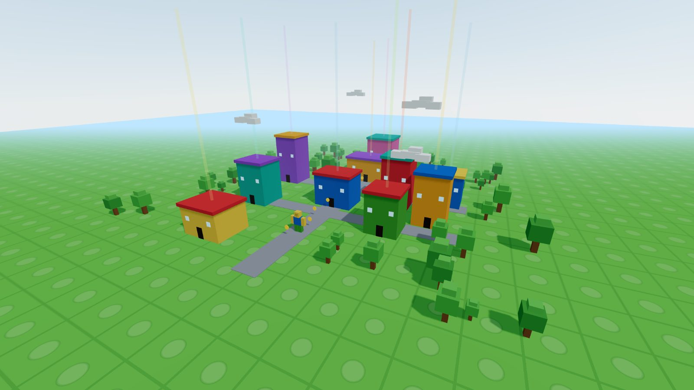
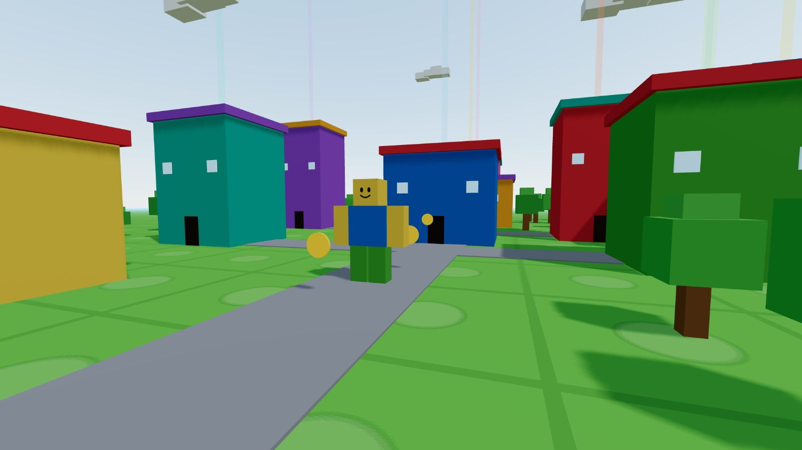

# portfolio-3d — Portfolio City

https://himavanthkar.github.io/portfolio-3d/

Himavanth Karpurapu's personal portfolio, built as a **walkable 3D city** with
**React Three Fiber** + **Three.js** + **Vite**. Every building is a part of the
résumé: walk up to one and its panel opens. Steer a blocky avatar in third-person,
or press **V** to drop into first-person. Colorful low-poly town — studded baseplate,
beacons you navigate by, trees, coins, real-time shadows.

> **v5 — current version.** Walk the city, **press `E` at a door to go inside** a building
> (a museum room + a big center panel with an "explain like I'm 5" **read-it-to-me**),
> **collect coins** (🪙 counter), and visit the Articles + Highlights buildings. Or hit
> **View everything** (top-right button / `R` key) for a flat résumé page. There's a lake, too.
> History: v1 scroll world, v2 walkable city, v3 (holographic interiors) dropped, v4 added the résumé page.

## Preview





## Run it

```bash
npm install
npm run dev
```

Then open the printed local URL (default http://localhost:5173).

## Controls

| | |
| --- | --- |
| **Move** | `W` `A` `S` `D` / arrow keys |
| **Look** | click to lock the mouse, then move it (`Esc` releases) |
| **Sprint / Jump** | `Shift` / `Space` |
| **Toggle 1st ⇄ 3rd person** | `V` |
| **Read a section** | walk up to a building — its panel opens automatically |
| **Enter a building** | press `E` at a door — museum room + a big panel with **🔊 read-it-to-me** |
| **Collect coins** | walk into them — the 🪙 counter goes up |
| **View everything** | the top-right button or press `R` — opens a flat résumé page (`#all`) |
| **Mobile** | on-screen joystick to move, drag to look |

## Make it yours

Edit **one file**: [`src/content.js`](src/content.js) — name, role, experience,
projects, skills, awards, and links. The city layout (which building is which
section, positions, colors) lives in [`src/world.js`](src/world.js).

## Structure

| File | What it does |
| --- | --- |
| `src/content.js` | All the résumé text/data. **Edit this.** |
| `src/world.js` | Deterministic city layout: buildings, roads, trees, spawn. |
| `src/state.js` | Shared mutable player state (no re-renders in the loop). |
| `src/Scene.jsx` | The `<Canvas>` — lights, sky, and the world composition. |
| `src/components/Player.jsx` | First/third-person controller, WASD, collision. |
| `src/components/Avatar.jsx` | The Noob, with a walk cycle. |
| `src/components/Buildings.jsx` | Section buildings, signs, and beacons. |
| `src/components/HUD.jsx` | Overlay: intro, minimap, view toggle, section panels. |
| `src/components/MobileControls.jsx` | Touch joystick + drag-look. |

## Build & deploy

```bash
npm run build
```

Outputs a static site to `dist/`. `vercel.json` is included for one-click Vercel deploys.

## Notes

- Third-person by default; first-person toggle (`V`). Auto third-person + joystick on touch.
- Collision uses a spatial hash so the avatar slides along walls.
- Real-time shadows; DPR capped for performance; render loop pauses when the tab is hidden.
